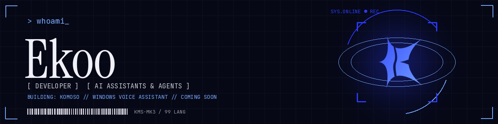

  

<h2 align="center">Hey, I'm Ekoo 👋</h2>

  Developer building voice assistants and AI agents.

---

### ⚡ Currently building: Komoso

**[Komoso](https://github.com/EKOKAYGZ/komoso)** is a voice assistant for Windows. You talk to it and it gets things done on your PC: opening apps, managing files, searching the web, remembering what matters to you.

- 🎙️ Real-time voice conversation powered by Gemini Live
- 🧠 Long-term memory that learns your preferences
- 🧩 Planned skill marketplace, so anyone can add new abilities
- 🖥️ Native Windows automation

 

---

### 📊 GitHub stats

  
  

  

